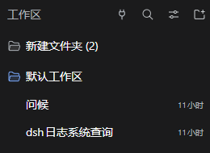

# DSH Tiered Plugin Menu

[简体中文](README.md) | English

**[Download center: Desktop / Web · TUI · dsh-go](https://kazari-qwp.github.io/dsh-tiered-plugin-menu/)** — Separate latest versions and download histories for each interface. The shared core installs automatically.

**Enable or disable DSH plugins, MCP servers and skills independently for each workspace and each session, with different settings for each.**

For example, enable a plugin only in your coding workspace and keep it off elsewhere. Use configuration A in one session and configuration B in another. Open the menu from the small plugin buttons in the sidebar, then expand **Settings** to use the plugin's original configuration UI.

Settings inherit through **client → parent workspace → child workspace → session**, at any workspace depth. Keep the parent's settings by default, or override them for a workspace or an individual session.

## Multi-platform components

| Package | Role |
| --- | --- |
| `dsh-tiered-plugin-core` | Shared inheritance, instances, dependencies, MCP and Skills |
| `dsh-tiered-plugin-menu` | Existing desktop/Web UI, keeping the package name and configuration path |
| `dsh-tiered-plugin-tui` | Terminal panel using the host's React and dialogs |
| `dsh-tiered-plugin-go` | Native mobile menu and scope routing for other native plugin contributions |

Packages have independent versions. Adapters depend on a compatible core version range; a core patch does not require publishing all adapters. Interfaces attached to **one DSH host share one core and plugin instances**. Closing one interface leaves others and background tasks running. Separate DSH processes have separate managers.

All interfaces manage third-party and official plugins, MCP, Skills and child defaults. Web reuses original settings components; TUI edits fields and mobile uses JSON forms. See [TUI](packages/tui/README.md), [dsh-go](packages/dsh-go/README.md) and [component architecture](docs/COMPONENTS.md).

### Install one package for your interface

| Interface | Package |
| --- | --- |
| Desktop / Web | `dsh-tiered-plugin-menu` |
| dsh-TUI | `dsh-tiered-plugin-tui` |
| dsh-go | `dsh-tiered-plugin-go` |

Each interface bundle declares a core component and an interface component. It automatically registers and enables the shared core through Harness package management. No separate core installation is required.

```sh
dsh plugin --profile <profile> add dsh-tiered-plugin-tui
```

Use the profile actually used by your interface. Restart when Harness requests it, then open **分级配置** in TUI's sidebar panel picker.

### Update in Harness

Click **Refresh** on the Plugins page, then update the package you want. Core and interface versions are managed separately. The interface's **Component versions** section links to core management.

## MCP and skills

The left navigation switches between **Plugins / Official plugins / MCP / Skill**. All categories reuse scope inheritance and new-child defaults. Edit each child default directly. Reset all to inherit clears child-default overrides across every category; defaults are copied only when a child is created.

The official tab reads Harness bundle metadata, including locally shipped plugins that are disabled at client scope. Enable them independently for a workspace or session. Package controls affect all components; open details to configure individual components. Optional packages not present locally must first be installed through Harness. Host infrastructure is excluded.

Official and third-party packages share the same dependency and instance handling, without plugin-name-specific patches. Compatibility declarations come from package metadata; official packages follow the same confirmation rules.

- **MCP:** discovers existing `@deepseek-ai/dsh-mcp-client` entries and supports adding servers with JSON connection settings (stdio or streamable-http). Inherited configuration shares its parent's connection. A local override starts a separate connection, including a separate process for stdio. Tools, resources and server instructions follow the selected scope. Background connections survive navigation away from a session.
- **Skills:** lists filesystem and plugin-provided skills available in the current scope. Each can be enabled or disabled, with optional overrides for its description, body and model/user invocation flags. Overrides live in the menu's configuration; original files remain unchanged. Skill providers, scripts and resource directories remain shared. Changes affect subsequent skill discovery/loading, not text already in conversation history.

MCP command arguments, environment, working directory, URL and headers can differ per scope. Remote services and external-process storage are independent only when their configuration makes them so. Disabling the menu releases its added MCP connections and restores native DSH entries; enabling it restores saved scope settings.

## Where to find the buttons



- **Client plugins**: the **plug icon** beside the **Workspaces** heading sets the default plugins and configuration for the client.
- **Workspace plugins**: hover over a workspace row, then click its plug icon.
- **Session plugins**: hover over a session row, then click its plug icon.
- **New session**: after choosing a workspace, click **分级配置** to the right of the workspace and agent-preset controls above the composer. Configure the current session and its child defaults before sending the first message.
- **Conversation tab**: open **分级配置** at the top of a conversation to edit its own settings and new-child defaults for plugins, MCP and skills. Navigating into a child or grandchild agent targets the displayed session, preserving recursive parent-agent inheritance. The tab uses DSH's official slot and coexists with tabs from Context and other plugins.

Workspace and session buttons appear on hover, so they are hidden on the unhovered rows in this screenshot.

On rc.1, the conversation tab is another entry point to the existing session menu. On rc.2, it also works after navigating into a subagent. Both use the same configuration and inheritance logic; upgrading to rc.2 is not required.

## Install

In DSH, open **Plugins → Add plugin** and enter the npm package name:

```text
dsh-tiered-plugin-menu
```

Or install from the command line:

```sh
dsh plugin --profile desktop add dsh-tiered-plugin-menu
```

Prebuilt `.tgz` packages are also available from [Releases](https://github.com/kazari-qwp/dsh-tiered-plugin-menu/releases).

For Web, use your profile name (usually `web`). Restart DSH if hot reload is disabled. No companion plugin is required.

The release includes compiled host/browser code, the bundle patch and licenses. It needs no install-time build script. A GitHub source checkout must be built first; use the release tarball for installation. This follows the [official DSH packaging guide](https://github.com/deepseek-ai/deepseek-harness/blob/master/docs/user/develop/basic/publish.md).

## Use

- The plugin icon beside **Workspaces** opens client settings. Icons on workspace/session rows open that scope's settings.
- The outer list shows **one row per package**. Its **Inherit | Enable | Disable** buttons apply to every component in the package.
- Click a package to open its component list. Control components individually there; a mixed package displays **partially enabled**.
- **Settings** expands the original plugin configuration cards when available, with a JSON editor as fallback. Cards from both Settings and plugin details are shown separately, divided by a line.
- Official and third-party plugins can save configuration while locally disabled; enabling applies it. Saves apply immediately to enabled plugins and never change the enablement mode. Choose a local on/off override before editing inherited settings. The category navigation stays visible while the content scrolls.
- Disabling a scope blocks the inherited instance. An explicitly enabled child can still override a disabled parent.
- Client scope uses the original DSH entries and native switches; lower scopes create separate instances. The optional experimental isolation switch also gives client entries private environments. Leaving a view does not stop background agents.
- Closing an interface removes its UI. The last interface component releases lower-scope instances and endpoints, retaining saved settings. The original frontend is restored only for plugins enabled at client scope.
- Choosing another session changes the active frontend binding; visiting Insights or Settings keeps that binding.
- Updating an installed plugin replaces its scoped frontend and open configuration cards after DSH finishes reloading its module and CSS, keeping the selected session and its settings.

Example: client configuration A, workspace B, session C. That session uses C, inheriting sessions in its workspace use B, and other workspaces inherit A.

## Workspace tree inheritance

The menu's own Settings page includes **Inherit along workspace tree (按工作区树继承)**, enabled by default. Changes save and take effect immediately. The sidebar menus still edit plugins at each level.

The nearest registered ancestor directory is the parent, matching DSH's **Workspace Tree** grouping. Missing intermediate workspace registrations are skipped. Each plugin resolves its nearest explicit configuration; inheritance shares that ancestor's instance. Turning the switch off makes every workspace inherit directly from the client, while preserving explicit configurations and new-child defaults. Changing or deleting an ancestor also reconnects consumers of its services.

Deleting a workspace makes its sessions inherit from their new workspace, or from the client if ungrouped. Session overrides remain intact. The deleted workspace's own settings and child defaults are removed; restarting preserves the new ownership.

This describes directory hierarchy, not Agent ownership: a Superagent Worker can inherit its Router's workspace configuration when its directory is below the Router's directory, even though the Worker is not a native DSH subagent.

## Experimental plugin isolation

**Plugin isolation (experimental / 插件隔离（实验性）)** is the second switch in the menu's Settings. It is **off by default**, including on upgrade. Changes save immediately and take effect after restarting DSH.

It gives plugins relatively independent environments. This may fix some compatibility issues, but may also introduce new ones.

When enabled, isolation starts at client scope. It reuses the module loading, directory redirection, service routing and lifecycle handling of workspace/session instances. Tools, skills, commands, prompt sections and projection keys receive stable plugin-qualified names, so two plugins with the same tool name can both serve **the same session**. Explicit service dependencies remain connected; unrelated services stay private.

Private client data starts fresh in `<config-filename>.data/`; existing plugin directories stay in place. Turning isolation off and restarting returns client entries to their original data. Fixed ports, external processes, conflicting preset IDs, and plugin code that requires another plugin's original public names are not covered. [Isolation behavior and limits](docs/PLUGIN_ISOLATION.md).

## Defaults for new children

Every menu opens on **This level (本级)** and has a **Children (下级)** tab. Edit each child's default directly, reusing the original configuration cards. **Reset all to inherit (全部重置为继承)** clears child-default overrides for plugins, official plugins, MCP and Skills at the current level. It leaves this level and existing child instances unchanged.

| Parent menu | Defaults apply to |
| --- | --- |
| Client | New top-level workspaces (all workspaces when tree inheritance is off), and new sessions without a workspace |
| Workspace | New ordinary sessions; new child workspaces when tree inheritance is on |
| Session | New subagents, recursively including their descendants |

Explicit on/off entries are copied into each new child; plugins left on Inherit continue to use their parent. Editing defaults starts no preview instance and changes no existing workspace, session or subagent. Resuming sessions, restarting DSH and reopening workspaces do not reapply defaults.

Overrides configured for the current session on the new-session screen take priority over child defaults. Items without a session override still use defaults or inherited settings.

Subagents follow their actual parent chain to the nearest child-default override for each item. Editing one item preserves inheritance for the others. Each new instance receives its own configuration copy. An ordinary conversation fork is not classified as a subagent just because it records a parent session ID.

Nested workspaces similarly resolve each item's default through ancestor workspaces. Existing children are never overwritten when a policy changes.

Scope settings live in `$DSH_HOME/plugins/tiered-plugin-menu.json`; the menu's `dataFile` option overrides that location. Client settings are persisted through DSH's native profile editor. Existing package-level settings migrate to component keys.

## Dependencies

Before changing switches, the menu calculates the complete affected set:

- Enabling a component lists any disabled dependencies and offers **Enable automatically / Cancel**.
- Disabling a provider lists enabled dependents and offers **Disable automatically / Cancel**. This includes descendant sessions that inherit the provider.
- A missing/uninstalled dependency produces an error and changes no switches. Nothing is installed automatically.
- Sharing a package is not itself a dependency. The outer package buttons deliberately operate the whole package; individual controls use declared DSH services and observed runtime dependencies.

Confirmation applies to switches operated through this menu; DSH's own plugin page remains native.

## Automatic directory isolation

When a lower instance creates or ensures a directory through Node's file APIs, the menu assigns it a private directory. Identical logical paths can hold different data in different instances. Inheritance shares the ancestor's instance and directory; explicit enablement uses an independent instance. Configured paths remain unchanged, with no field-name guesses or plugin-name adapters.

Relative paths and `..` resolve in the original logical namespace before redirection. `realpath` returns logical paths, so subsequent child/parent lookups keep their meaning.

Data lives beside the menu configuration file in `<config-filename>.data/`, separated by scope and package. Menu restarts and session resumes reuse it. First use creates fresh private data; existing directories are neither moved nor deleted. See [directory isolation details](docs/DIRECTORY_ISOLATION.md).

## Compatibility capabilities

The menu uses generic mechanisms, without changing DSH or third-party source code or branching on individual plugin names:

- **Instances and configuration:** independent workspace/session instances; inheritance shares the ancestor instance, with scope-aware configuration and lifecycle.
- **Services and dependencies:** private services stay separate; declared dependencies connect to providers in the appropriate scope.
- **Registrations and names:** scoped tools, skills, commands, prompt sections, projections and HTTP registrations, including same-named contributions in different sessions.
- **Frontend and settings reuse:** original modules, CSS and configuration cards, supporting lower-scope activation while globally disabled and reloading after plugin updates.
- **Agent presets:** scope-specific configurations for identical preset IDs, preserving subagent revision references.
- **Private directories:** independent data directories while preserving logical relative-path, `..` and `realpath` behavior.
- **Bundles and resources:** package/component dependency controls, with the same inheritance rules for MCP and skills.

Experimental isolation extends this to client scope and qualifies registration names to address some same-session collisions. These mechanisms are not a security sandbox or a guarantee of arbitrary plugin compatibility. Fixed ports, external processes and access bypassing supported interfaces remain outside isolation.

See **[full compatibility documentation](docs/COMPATIBILITY.md)** for mechanisms, coverage, limits and test reports.

## Author compatibility declaration

After testing compatibility with this menu, plugin authors can declare the boolean **`Compatible`** in `package.json`:

```json
{
  "dsh": {
    "tieredPluginMenu": {
      "Compatible": true
    }
  }
}
```

`true` means the author has tested compatibility with this menu, including independent workspace, session and subagent instances and configurations. Missing or `false` values place the plugin under **Unverified compatibility (未验证兼容性)** at lower scopes, with confirmation before enablement. Official and third-party packages follow the same rule.

This is an author declaration, not DSH certification or a guarantee of compatibility with all other plugins. The menu never writes declarations for another package. [Author testing guidance and field semantics](docs/COMPATIBILITY.md#author-declaration)

## Development

```sh
npm ci --ignore-scripts
npm run check
npm run pack             # All four components in dist/
npm run pack -- core     # Only the core package
```

The checkout is self-contained. `vendor/` holds an unchanged MIT test fixture; no private repository access is needed. See [component development](docs/COMPONENTS.md) for building and validation.

Core implementation lives in `packages/core/src/`; the original Web client is in `packages/web/src/client/`. Terminal and mobile adapters live in `packages/tui/` and `packages/dsh-go/`.

Uninstall currently preserves configuration and private data outside the package directory. DSH updates also use removal/reinstallation, so data deletion is not tied to a generic removal or instance disposal. Reinstallation restores saved settings.

## License

[MIT](LICENSE): commercial use, modification and redistribution are permitted with the license notice retained. Bundled validation code and source test fixtures retain their notices in [THIRD_PARTY_NOTICES.txt](THIRD_PARTY_NOTICES.txt).
