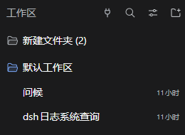

# 分级插件菜单

简体中文 | [English](README.en.md)

**[下载中心：桌面 / Web · TUI · dsh-go](https://kazari-qwp.github.io/dsh-tiered-plugin-menu/)** — 各端最新版本与历史安装包分别列出，共享核心自动安装。

**让每个工作区、每个会话都能独立开关 DSH 插件、MCP 和 Skill，并使用各自不同的配置。**

比如，只在写代码的工作区启用某个插件，在其他工作区关闭；同一个插件，在会话 A 使用配置 A，在会话 B 使用配置 B。直接从侧栏的小插件按钮打开菜单，在「设置」中使用原插件的配置界面。

配置按 **客户端 → 父工作区 → 子工作区 → 会话** 逐级继承，支持任意深度的工作区树。没有单独设置时沿用上级，需要时在工作区或单个会话里覆盖。

## 三端组件

同一套核心支持桌面/Web、dsh-TUI 和 dsh-go。各包独立版本、独立发布；兼容的核心修复只需发布核心包，无须同步发布三个界面。

| 包 | 职责 |
| --- | --- |
| `dsh-tiered-plugin-core` | 分级继承、插件实例、依赖、MCP 与 Skill；由界面自动依赖 |
| `dsh-tiered-plugin-menu` | 原桌面/Web 菜单，保留原包名和配置路径 |
| `dsh-tiered-plugin-tui` | 终端侧栏面板；使用 TUI 宿主 React 与对话框 |
| `dsh-tiered-plugin-go` | dsh-go 原生菜单，并按会话转发其他原生插件的界面注册 |

**挂在同一 DSH 宿主的界面共用一份核心和实例。** 关闭其中一个不会影响其他界面或后台任务；最后一个界面组件退出才释放运行中的管理器，核心宿主入口可以留待下次使用。分别启动的 DSH 进程各有自己的运行实例，不能仅靠共用文件夹实现内存共享。

三端都提供插件 / MCP / Skill、本级 / 下级默认、继承 / 启用 / 关闭和配置编辑。桌面继续复用插件原设置页；TUI 逐字段编辑，手机使用 JSON 表单。详见 [TUI](packages/tui/README.md)、[dsh-go](packages/dsh-go/README.md) 和 [架构与验证](docs/COMPONENTS.md)。已验证隔离虚拟机中的实际 TUI/Web，以及连接虚拟机后端的 Android 官方 APK；包括界面操作和完整冷启动，见 [测试截图与范围](docs/LIVE_UI_TESTING.md)。

### 只安装对应端的一个包

| 使用的客户端 | 安装包 |
| --- | --- |
| 桌面 / Web | `dsh-tiered-plugin-menu` |
| dsh-TUI | `dsh-tiered-plugin-tui` |
| dsh-go | `dsh-tiered-plugin-go` |

从 Web 0.9.0、TUI / dsh-go 0.2.0 起，每个界面包都声明「共享核心组件 + 界面组件」，并自动把核心登记到 Harness 原生包管理器。**不需要再手动安装或启用核心。** 多个界面仍共用一个核心。

TUI 示例（把 `<profile>` 换成实际 profile 名称）：

```sh
dsh plugin --profile <profile> add dsh-tiered-plugin-tui
```

核心登记或更新后，如果 Harness 提示重启，请重启后使用。TUI 重启后在侧栏面板选择器打开「分级配置」。

### 在 Harness 中更新

在「插件」页点 **刷新**，选择需要更新的包。核心和界面各有自己的版本和更新入口；界面详情页的「组件版本」列出两者，可跳转管理核心。

npm 来源的 0.7.1 可以直接更新到 0.9.0：更新一次界面包会自动补齐核心登记，原有设置和自定义 `dataFile` 路径保留。首次迁移可能需要重启，这是 Harness 的包路径切换要求；不是重新安装或重新配置。后续只修核心时，不必再升级界面包。本地 `.tgz` 来源仍按 Harness 的本地安装方式处理，不保证自动检查更新。[升级验证记录](docs/COMPONENT_UPDATES.md)。

## 按钮位置



- **客户端插件**：图中「工作区」总标题右侧的**插头图标**，设置整个客户端的默认插件与配置。
- **工作区插件**：鼠标悬停在工作区名称这一行，点击出现的插头图标。
- **会话插件**：鼠标悬停在会话名称这一行，点击出现的插头图标。
- **会话标签页**：打开会话顶部的「分级配置」，直接调整当前会话的「本级 / 下级」插件、MCP 和 Skill 设置。进入子代理或孙代理时，配置对象跟随当前显示的会话，沿父代理逐层继承。标签页使用 DSH 官方插槽，可与 Context 等插件的标签页并列使用。

工作区和会话按钮在悬停时显示，上图未悬停的行里不会显示按钮。

rc.1 中，「分级配置」只是原会话菜单的另一个入口；rc.2 中也可从子代理导航进入后使用。两者共用同一套配置和继承逻辑，不要求升级到 rc.2。

## 安装

在 DSH 的 **插件 → 添加插件** 中输入 npm 包名：

```text
dsh-tiered-plugin-menu
```

如果镜像源仍返回首次发布的占位包，请切换到 npm 官方源后重试。

也可以在命令行安装：

```sh
dsh plugin --profile desktop add dsh-tiered-plugin-menu
```

也可以从 [下载中心](https://kazari-qwp.github.io/dsh-tiered-plugin-menu/) 按客户端选择构建好的 `.tgz` 安装；完整发布记录见 [Releases](https://github.com/kazari-qwp/dsh-tiered-plugin-menu/releases)。

Web 版换成自己的 profile 名称，通常是 `web`。未开启热重载时重启 DSH。不需要预先安装临时消息等其他插件。

核心 0.8.1 中针对未启用插件必填配置的修复已包含在新核心中。旧版用户也可查看 [0.8.1 修复记录](docs/CORE_0.8.1.md)。

发行包包含宿主、浏览器构建产物、bundle patch 与许可，不需要安装时运行构建脚本。GitHub 源码需要先构建，直接安装请使用 Release 的 tarball。这是 [DSH 官方打包教程](https://github.com/deepseek-ai/deepseek-harness/blob/master/docs/user/develop/basic/publish.zh.md)支持的分发方式。

## 使用

- 侧栏「工作区」总标题旁的插件图标打开客户端配置；各工作区、会话行上的图标打开对应层级配置。
- 外层**一个包显示一项**，**继承｜启用｜关闭**按钮同时作用于包内全部组件。
- 点击包进入组件列表，才能逐个控制。组件开关不一致时，外层显示「部分启用」。
- 「设置」展开原插件的配置卡；没有可复用的配置卡时提供 JSON 编辑器。设置页与详情页都有配置卡时分别显示，中间用横线分隔。
- 本层关闭后不再执行继承来的实例；下级明确启用仍可覆盖上级关闭。
- 客户端级使用 DSH 原有入口和开关，下两级创建独立实例；可选的实验性隔离开关也会给客户端入口提供独立环境。离开页面不会卸载后台会话的实例。
- 关闭界面时移除其界面入口；最后一个界面组件关闭时，释放下级实例与接口，保留持久化配置；再次开启时恢复。只有客户端级原本启用的插件会恢复原生前端。
- 选中另一个会话时切换前端绑定；进入洞察、设置等页面保留当前绑定。
- 更新已安装插件时，等待 DSH 完成模块与 CSS 重载，再更新下级前端和已打开的配置卡，保留选中的会话及其配置。

例如客户端配置 A、工作区配置 B、其中一个会话配置 C：该会话用 C，同工作区其他继承的会话用 B，其他工作区继承 A。

## MCP 与 Skill

菜单左侧可切换 **插件 / MCP / Skill**，三者使用同一套本级、下级默认设置和树状继承规则。「下级」的继承／独立总开关作用于这三类配置；默认值只在新建下级时应用。

- **MCP**：自动识别 DSH 配置中的 `@deepseek-ai/dsh-mcp-client` 入口，也可点击「添加 MCP」。设置中填写连接参数 JSON，支持 stdio 与 streamable-http。继承时共用上级连接；本级独立启用时创建独立连接，stdio 会启动独立进程。工具、资源及服务器提示信息一起按作用域生效，离开会话页面不会断开后台连接。
- **Skill**：显示 DSH 技能注册表中本作用域可用的文件技能和插件注册技能，支持逐项开关，并可覆盖说明、正文和模型／用户调用权限。覆盖只存入菜单配置，不修改原始 `SKILL.md`。技能来源、附带脚本和资源目录仍共用，未复制为独立执行环境。更改影响后续技能查询和加载，不改写已经进入对话的内容。

例如，一个 MCP 的本级配置可以是：

```json
{
  "serverName": "my-server",
  "transport": "streamable-http",
  "url": "http://127.0.0.1:3000/mcp",
  "headers": {}
}
```

MCP 的命令、环境变量、目录、URL 和请求头可以分级设置；远端服务和外部进程的存储是否独立仍取决于这些配置。关闭菜单时，菜单新增的 MCP 连接会释放，DSH 原有入口交回 DSH 管理；保存的分级设置在再次开启菜单后恢复。

[MCP / Skill 测试范围与复现方式](docs/RESOURCES.md)。

## 按工作区树继承

菜单自己的设置页中，**按工作区树继承** 默认开启，修改后立即保存生效。各层插件仍在侧栏菜单中配置。

父级取最近的已注册上级目录，与 DSH 的「工作区树」分组一致；未注册的中间目录会跳过。每个插件沿树寻找最近的明确配置，继承时共用上级实例。关闭开关后，各工作区直接继承客户端，已有独立配置和下级默认设置仍保留。改变或删除上级时，依赖其服务的组件也会重新连接。

目录层级与 Agent 的父子关系分别处理：Superagent 的 Worker 目录位于 Router 目录下时，可以继承 Router **所在工作区**的配置，即使 Worker 并不是 DSH 原生子 agent。

## 插件隔离（实验性）

菜单设置页的第二个开关是 **插件隔离（实验性）**，**默认关闭，升级后也不会自动开启**。修改后立即保存，重启 DSH 生效。

给插件提供相对独立的环境，可能能修复一些兼容性问题，但也可能带来更多兼容性问题。

开启后从客户端级开始隔离，复用工作区／会话实例已有的模块加载、目录重定向、服务路由和释放逻辑。工具、技能、命令、提示词片段、统计投影使用带插件标识的稳定名称，让两个工具同名的插件也能在**同一个会话**中共存。有明确声明的服务依赖继续连接，其余服务保持独立。

客户端私有数据首次从 `<配置文件名>.data/` 中的新目录开始，原插件目录保留；关闭隔离并重启后，客户端入口恢复使用原目录。固定端口、外部进程、同名 Agent 预设，以及依赖其他插件原始公开名称的代码不在此次覆盖范围内。[实测范围与限制](docs/PLUGIN_ISOLATION.md)。

## 下级默认设置

每个菜单都有 **本级｜下级** 选项卡，默认打开本级。下级页面的总开关默认为 **继承**，切到 **独立** 后可以设置下级的插件开关，并复用原插件的配置卡。

| 在哪里设置「下级」 | 用于哪些新实例 |
| --- | --- |
| 客户端 | 新顶层工作区（关闭树继承时为所有新工作区），以及没有归属工作区的新会话 |
| 工作区 | 新普通会话；开启树继承时也用于新子工作区 |
| 会话 | 新子 agent，包括后续各级子 agent |

独立下级设置中明确启用或关闭的插件，会在新建时复制到对应实例；仍选「继承」的插件继续沿用上级。编辑默认值不会启动测试实例，也不会改写已有工作区、会话或子 agent。恢复会话、重启和重新打开工作区都不会重新应用默认值。

子 agent 按实际父子关系查找最近的独立下级设置；自身没有另设时，继续沿用父会话的下级默认设置，因此可以传到孙 agent。它们各自获得独立的配置副本。普通会话分叉不会因为记录了父会话 ID 就被当成子 agent。

嵌套工作区同样查找最近的独立工作区下级设置；更改默认值不会覆盖已经创建的下级。

分层配置保存在 `$DSH_HOME/plugins/tiered-plugin-menu.json`，可通过菜单插件的 `dataFile` 更改。客户端配置通过 DSH 原生配置编辑器写入 profile。已有的整包配置会迁移到组件配置项。

## 依赖处理

修改开关前，菜单先计算完整的影响范围：

- 启用组件时，如果依赖尚未启用，列出依赖并提供**自动启用／取消**。
- 关闭被依赖的组件时，列出仍在使用它的组件并提供**自动关闭／取消**，也包含继承该依赖的下级会话。
- 依赖根本没安装或不可用时直接报错，开关保持原状，**不会自动安装**。
- 属于同一个包不代表互相依赖。外层开关按整包操作；详情页的单独开关根据 DSH 服务声明及已观察到的运行依赖处理。

这些确认规则作用于本菜单内的操作；DSH 自带插件页仍按其原生逻辑运行。

## 自动目录隔离

下级实例通过 Node 文件接口创建或确保目录存在时，菜单为它分配私有目录；同样的逻辑路径可以在不同实例中保存不同数据。继承上级实例时共用上级目录，独立启用时使用自己的目录。配置里的路径保持原样，不依赖 `stateDir` 等字段名，也不按插件名称适配。

相对路径和 `..` 先在原来的逻辑路径中解析，再决定是否重定向；`realpath` 返回逻辑路径，因此继续拼接子路径或访问上级不会误入内部存储目录。普通文件接口与 SQLite 打开路径已经测试，Superagent 的两个下级实例使用相同 `stateDir`，也能分别持有锁和数据库。

数据保存在菜单配置文件旁的 `<配置文件名>.data/` 中，按作用域和包区分；重开菜单或恢复会话继续使用原来的私有数据。首次使用隔离功能时创建新的私有数据目录，已有目录不会被搬动或删除。[实测结果与覆盖范围](docs/DIRECTORY_ISOLATION.md)。

## 兼容情况

组件已独立发布；测试环境为 **DSH 0.2.2-rc.1 / rc.2**、Node.js 24。支持整包、组件开关和依赖确认，通过 DSH 的通用机制实现，不按具体插件名称写适配，不修改 DSH 或第三方插件源码。

0.7.1 取消 DSH 的精确版本限制：不再声明 `engines.dsh`，DSH 宿主依赖使用 `*`，升级 DSH 不会仅因版本号变化被本插件的声明拦截。新版移除 `agents.isOwnedBy` 后，菜单通过会话元数据识别父子关系。开发依赖仍固定版本，便于重复构建和测试。

0.6.1 修复开启实验性隔离后，点击旧会话导致侧栏条目消失的问题：私有辅助服务不再错误替换宿主服务。原会话文件未丢失，更新后重启 DSH 即可重新加载。[原因与回归检查](docs/PLUGIN_ISOLATION.md#061-session-restoration-fix)。

自动识别已安装的包。下两级中，未声明自兼容性的插件放在「未验证自兼容性」分组，启用前需要确认；不会因为启动成功就自动标记已验证。

实现上按作用域隔离插件提供的服务，并转发 DSH 的工具、提示词、命令、技能、统计投影和 HTTP 等共享注册。下级实例进入真实 Loader 入口，因此即使客户端级关闭，DSH 也能加载**已安装包的原前端和 CSS**。菜单不再内嵌第三方前端副本。

不同插件也能同时注册同名技能提供器和技能：先筛选当前会话可见的来源，再由 DSH 处理技能优先级；释放一个来源不会移除其他来源。[技能隔离与 0.5.2 回归结果](docs/SKILLS.md)。

工具同名的插件可以分别在不同工作区、不同会话启用。下级工具使用 DSH 原生的逐 Agent 注册，参数、执行函数和结果渲染各自独立。可选的实验性开关进一步通过不同的公开名称处理同一会话内的工具重名。[工具隔离与 0.5.3 结果](docs/TOOLS.md)、[实验性隔离实测](docs/PLUGIN_ISOLATION.md)。

Agent 预设声明也按作用域隔离：不同工作区、会话可以使用同名预设的不同配置，不再重复注册报错。保留原预设 ID 和 DSH 的版本持有机制，子 agent 仍能使用父 agent 持有的预设版本。这一适配使用当前锁定 DSH 版本的声明表，并非跨版本稳定接口。[Superagent 实测范围与上游问题](docs/SUPERAGENT.md)。

0.2.1 的更新修复经过旧版菜单对照复现，并使用原版 dsh-context 0.82.2 → 0.83.0 前端包验证：洞察页渲染、CSS 替换、会话配置保留，以及模块短暂移除后重新加载均通过。[更新回归说明](docs/CLIENT_UPDATES.md)。

隔离测试包含十个包。临时消息、dsh-context、通知在两个工作区、四个会话中通过 **54 组功能开关组合**。另外七个样本逐个验证了生命周期、独立配置及原前端模块可见性；Clock 的原配置组件另测了两个会话分别保存。[具体结果、版本和复现方法](docs/COMPATIBILITY.md)。

第二批又加入 Better Sidebar、Agent Teams、另一款记忆插件、Force Compact、Bill、Auto Mode、Workbench 和 Simplify，共八个新样本。下级混装通过 **110/110 项生命周期与配置检查**，实测修复了菜单不兼容自定义统计校验器的问题。Workbench 的原生路由清理失败在不装菜单时也复现。[第二批报告](docs/SECOND_BATCH.md)。

0.5.1 的第三批把八个新插件与原来的十八个混装。排除不装菜单也会发生的记忆工具重名冲突后，25 个包通过 **341/341 项下级生命周期与配置检查**。本轮发现并补齐了技能注册隔离：打包技能和运行时技能会随当前工作区、会话选择实例，并随实例释放。[第三批结果与原生对照](docs/THIRD_BATCH.md)。

`@fooxe/dsh-memory` 在不装菜单时也存在原生 HTTP 路由清理问题。本次测试中，从原生实例未启用的干净进程启动，下级用例可通过；菜单不会清理它先前留下的原生注册。

这里隔离配置、生命周期及上述文件访问，**不是安全沙箱**。未进入私有目录的全局文件、写死的 TCP 端口、原生扩展和外部进程的文件访问不在这层隔离范围。没有穷尽测试每个第三方工具、UI 操作和远程接口；绕过已测试 DSH 接口的自定义前端仍可能需要进一步处理。

## 自兼容性声明

自兼容性指同一插件的多个独立实例能够同时运行，各自使用独立的配置和运行状态。插件作者可以在 `package.json` 用布尔值声明：

```json
{
  "dsh": {
    "tieredPluginMenu": {
      "selfCompatible": true
    }
  }
}
```

`true` 表示作者声明自兼容，统一适用于工作区、会话及子 agent；`false` 或未填写仍视为未验证，启用时需要确认。它不代表该插件与其他插件互相兼容。这是本菜单的约定，不是 DSH 官方认证。自家临时消息插件也遵循同样规则，菜单不会代替其他插件写入声明。

从 0.5.4 起，`selfCompatible` 替代 `supportsChildInstances`。声明过旧字段的插件需同步改名，菜单不再读取旧字段。

## 开发

```sh
npm ci --ignore-scripts
npm run check
npm run pack             # 打包四个组件到 dist/
npm run pack -- core     # 只打包核心
```

可以在独立 checkout 中构建。`vendor/` 包含未经改动的 MIT 测试依赖，不需要访问私有仓库。`check` 执行类型检查、构建和串行回归测试，使用真实 DSH 服务/插件及 React/jsdom，不使用浏览器自动化或付费模型。覆盖下级默认设置、深层工作区树、实时切换继承、预设隔离、会话恢复、配置卡、MCP/Skill、共享核心生命周期和 TUI 键盘操作。dsh-go 官方 SDK/桥接验证单独运行，见 [组件开发说明](docs/COMPONENTS.md)。

大规模第三方测试在一次性断网虚拟机内运行，见 [复现说明](docs/COMPATIBILITY.md#reproduce)。这些步骤不向个人 DSH 实例安装测试样本。

主要文件：`packages/core/src/manager.ts` 管理实例和继承；同目录的 `dependencies.ts` 计算依赖，`runtime-tree.ts` 管理 Loader 入口，`scoped-services.ts` 转发共享注册。`packages/web/src/client/` 保留原菜单；`packages/tui/` 与 `packages/dsh-go/` 是独立界面适配包。

卸载目前保留包目录之外的配置和插件私有数据。DSH 的更新也会使用移除/重装流程，因此不把删配置绑定到普通卸载或实例释放；重装会恢复原设置。

## 许可

[MIT](LICENSE)，允许商用、修改和分发，保留许可声明即可。打包的校验库及源码测试依赖保留原许可，见 [THIRD_PARTY_NOTICES.txt](THIRD_PARTY_NOTICES.txt)。
