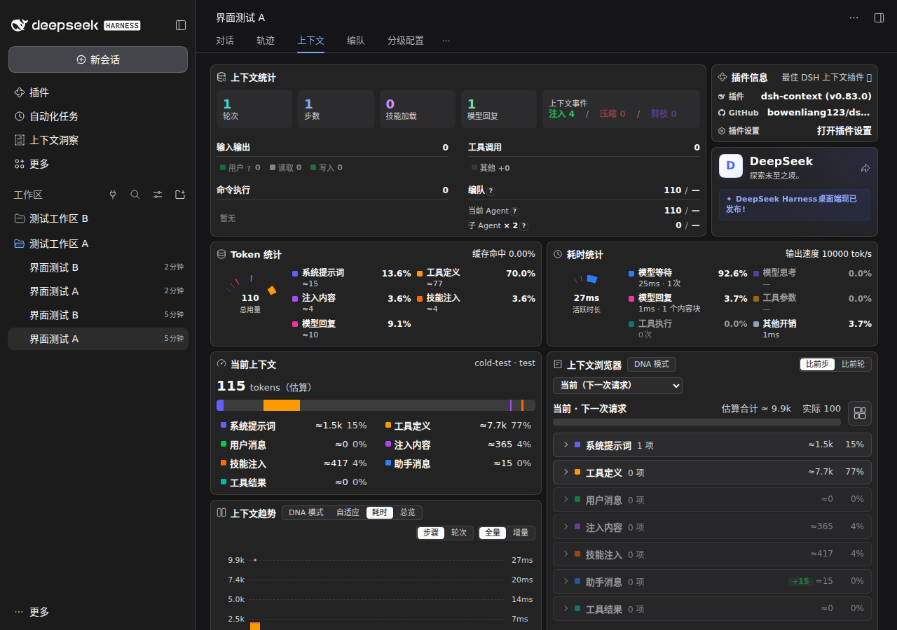
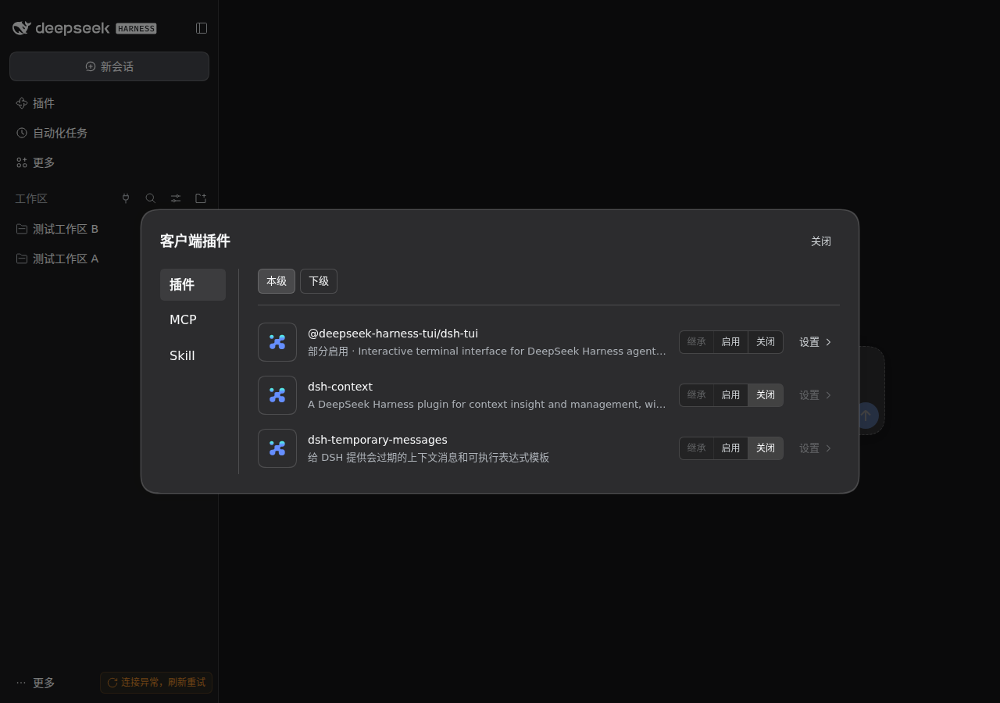
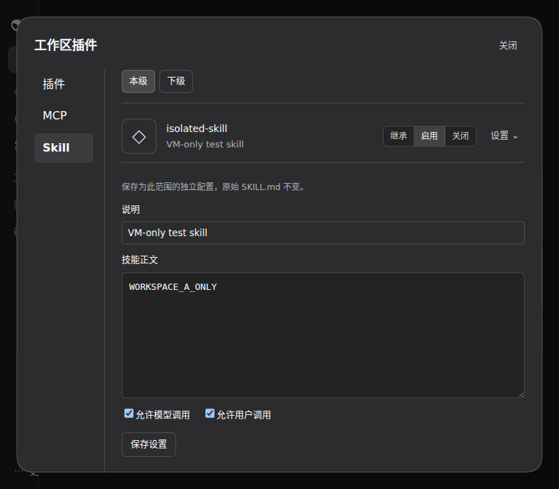
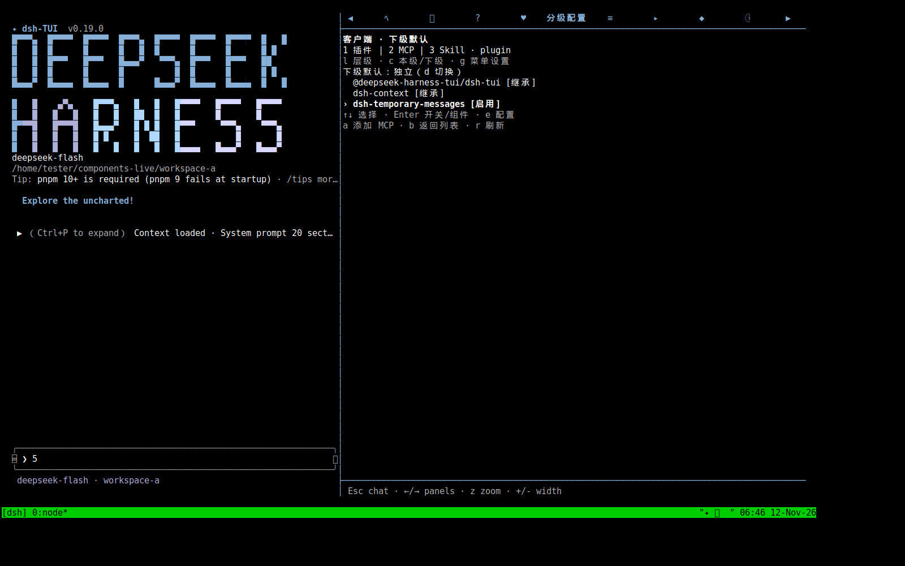
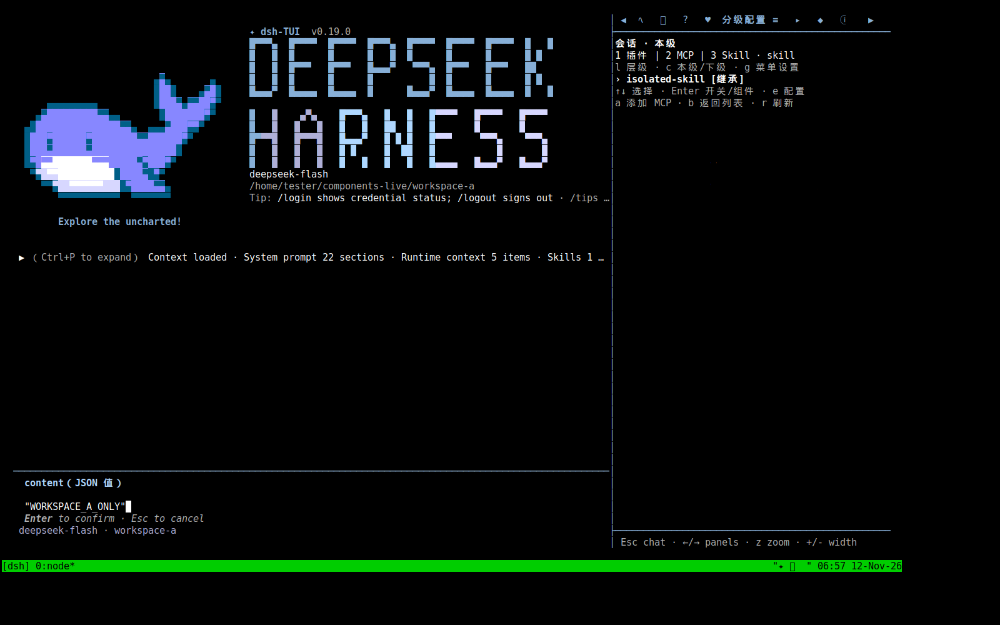
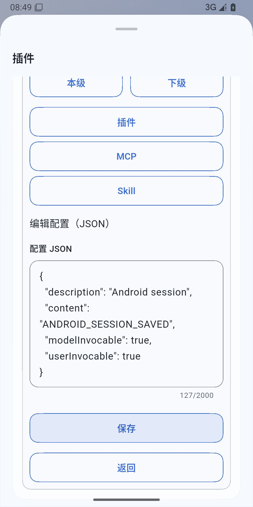
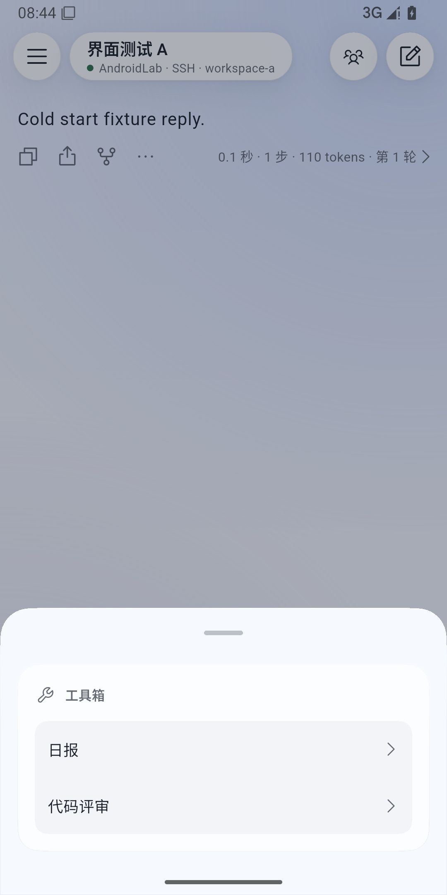

# 实际 TUI / Web / Android 界面测试

2026-11-12，在 Ubuntu 24.04 虚拟机内安装开发 tarball，加载实际的 dsh-TUI 0.19.0 与 DSH 0.2.2-rc.1。Web 和 TUI 使用同一个 Node 后端、同一个分级核心。终端通过 tmux / xterm 运行，Web 使用 Chromium；截图来自实际窗口。

虚拟磁盘、依赖缓存、临时文件和截图保存在 E 盘。测试进程使用独立账户和仅有 loopback 的网络命名空间，未导入个人凭据或会话，未调用付费模型。测试的是实际界面与真实 DSH/MCP 服务，截图中的会话没有模型回复。

## 冷启动验收要求

后续实测必须包含冷启动：完全退出 DSH 后端与客户端进程，再从实际安装包启动。热运行时切换开关和重新加载插件不能替代冷启动验收。分别检查新配置首次启用，以及已有配置在新进程中的恢复；检查实际入口、页面和数据，不能只依据后端状态或“保存成功”。多端测试同时覆盖独立启动与共享后端。

2026-11-12 的共享核心回归：Web 适配器独立安装时，核心没有自己的 Loader 父入口，导致下级后端运行正常，但 DSH 无法发现对应的前端模块。修复把这些临时入口登记到根索引，释放时移除，不写入客户端 profile。未修改外部插件。

在实际 DSH rc.2 + 原版 dsh-context 0.83.0 中复现并验证：客户端关闭、会话独立启用；冷启动恢复已有会话；插件隔离开启；上下文统计页面正常显示；切到未启用的会话隐藏入口。后端和 Chromium 均重新启动，模型回复由本地固定测试适配器生成。页面无 JavaScript 错误。60 项自动回归通过，另补充共享核心入口发现、索引解析、多界面存活和最后释放的断言。



## 原有多端验收

| 操作 | 结果 |
| --- | --- |
| Web 打开客户端和工作区菜单 | 插件 / MCP / Skill 标签、本级 / 下级、开关与展开配置可用 |
| 原“临时消息”配置页 | 复用原组件；Web 保存模板后，TUI 字段编辑器读到同一值 |
| TUI 修改模板 | Web 重新打开配置页读到 TUI 的修改 |
| 下级默认 | TUI 可切换独立默认，并执行插件启用的二次确认 |
| MCP | Web 添加真实 stdio 测试服务，TUI 中可发现同一个服务器 |
| Skill | 加载真实 SKILL.md；客户端正文覆盖被工作区继承，工作区独立正文被 TUI 当前会话继承；会话关闭技能后显示关闭 |
| 重启 | 重启真实宿主后仍能读取已保存的配置 |
| 单独关闭 Web 适配入口 | 核心仍存在，TUI 面板仍可刷新和读取配置 |
| 布局 | 检查 1280×900、800×700 Web 窗口及 160×48、110×32 终端；控件未重叠，窄终端提示正常换行 |

## 实测发现并修复

1. TUI 限制插件从根 Context 挂载组件。改为显式核心 bundle 在自己的 Context 挂载，TUI 等待该服务；不绕开宿主限制。
2. 多入口包可以保留当前宿主没有安装的旧版组件。列出禁用组件时不再因缺少模块而中止整个菜单；真正启用不存在的模块仍会报错。
3. 原配置可以含 Loader 的 `!!js` 表达式。读取时使用 Loader 自带的求值接口，再按原插件 schema 解析，不修改保存的表达式。
4. TUI 中部分组件启用的包此前显示“关闭”，改为“部分启用”。

修复均针对通用接口，未修改 DSH、dsh-TUI 或外部插件源码。自动回归另覆盖核心重开、旧 Web 入口、插件隔离、MCP/Skill、子/孙代理继承以及 dsh-go 原生注册路由。

最终 `npm run check`：类型检查、构建、60 项测试全部通过。`npm run test:go -- <dsh-go 源码目录>`：官方 NativeCore 多实例路由、数据订阅、释放和 SDK 菜单校验通过。四个组件已重新打包，仍为未发布开发产物。

## 截图

Web 插件列表：



Web 窄窗口中的工作区 Skill 配置：



TUI 下级默认设置：



TUI 当前会话读到工作区独立 Skill 正文：



## Android 实际界面与冷启动

同日追加 Android 15 模拟器测试：官方 dsh-go 1.0.15 ARM64 APK，1080×2160 / 420 dpi，通过 App 自身的受管 SSH 连接 Ubuntu 虚拟机内的 DSH rc.2 与官方原生桥接 0.4.0。Android SDK、AVD、缓存和截图均在 E 盘。使用独立测试 profile 和本地固定回复适配器，没有导入个人凭据或调用付费模型。

| 操作 | 实际结果 |
| --- | --- |
| 客户端 / 工作区 / 会话 Skill 编辑 | 分别保存不同正文；会话编辑前读到工作区正文，覆盖后其他会话仍按各自层级继承 |
| 添加会话 MCP | 安卓 JSON 表单添加真实 stdio 服务；冷启动后 DSH 实际调用返回 `ANDROID_SESSION`，其他会话没有该工具 |
| 原生插件会话启用 | 客户端关闭的官方 Toolbox 在会话 A 单独启用；模板面板可点击并插入当前草稿，回合注释可见 |
| 切到未启用会话 | 不显示 Toolbox 回合注释；包级入口仍可见，但面板提示“此会话未启用该插件”，不会调用 A 的实例 |
| 会话下级默认 | 从安卓设置独立 Skill 默认；冷启动后创建子代理和孙代理，实际读取的正文都是 `ANDROID_CHILDREN_SAVED` |
| 完整冷启动 | 强制停止 App 并终止专用后端；新进程恢复同一批已保存会话，页面能读回 Skill、MCP 和下级默认，原生回合注释恢复 |
| 布局 | 检查展开、滚动、选择层级、JSON 输入和保存；未见按钮重叠，原生宿主会将三按钮组纵向排列，页面较长 |

实测发现：切换层级实际成功，却出现“未保存”。即时输入动作在返回响应前推送了页面刷新，App 因视图已被替换而把响应判为过期。改为通过即时动作响应刷新页面；异步按钮仍使用原有推送。修复后在真实 App 重测切换通过，官方 SDK 也增加了“输入响应前不得提前刷新”的断言。没有修改 dsh-go 或第三方插件。

冷启动后各会话的实际 Skill 读取结果为：A → `ANDROID_SESSION_SAVED`，同工作区 B → `ANDROID_WORKSPACE_SAVED`，另一工作区 C → `ANDROID_CLIENT_SAVED`。60 项自动测试、类型检查、构建及官方 SDK 检查通过。





## 范围与限制

- 该版本官方 TUI 的依赖声明只接受到 DSH rc.1，rc.2 会跳过其 bundle。这次未放宽或修改官方声明，TUI 视觉测试使用 rc.1。此前的 rc.2 后端测试不能当作 rc.2 TUI 实测。
- Web 显示“连接异常，刷新重试”；在完全不加载分级核心和三个适配器的同版本对照 profile 中也复现。菜单 HTTP 请求与配置操作可用；这次未修复该宿主连接现象，也未据此宣称所有 Web 订阅和会话导航均正常。
- Android 测试覆盖真实 APK + 模拟器 + SSH 后端；未测试物理手机或手机本地 PRoot 引擎。测试中的子/孙代理由 DSH API 创建并验证继承，未验证安卓团队页中的子代理导航。
- 这次不是所有外部插件、所有 TUI 终端类型的全量兼容认证。

## TUI profile 要点

安装核心依赖文件与启用核心 bundle 是两步。已有的 TUI profile 应包含以下 bundle 顺序（其余既有 bundle 保留）：

```json
{
  "dsh": {
    "profile": {
      "bundles": [
        "@deepseek-ai/dsh-base",
        "@deepseek-ai/dsh-web-app",
        "dsh-tiered-plugin-core",
        "@deepseek-harness-tui/dsh-tui",
        "dsh-tiered-plugin-menu",
        "dsh-tiered-plugin-tui"
      ]
    }
  }
}
```

未发布组件用本地 tarball 和包管理器 override 安装；不要把开发机 `file:` 路径写进发布依赖。

## English

Cold-start verification is required for future UI and lifecycle changes: stop both host and client processes, launch the installed artifacts, and check first activation and persisted-state restoration in the actual UI. Reloading a plugin in a warm process is insufficient. A shared-core regression was reproduced and fixed by exposing otherwise detached runtime entries in the Loader root index without persisting them. Live DSH rc.2 / unmodified dsh-context 0.83.0 checks passed with the client plugin disabled, session activation, isolation enabled, cold restoration, and hiding the UI in another session.

Live VM testing used Ubuntu 24.04, real dsh-TUI 0.19.0 and DSH rc.1, with Web sharing the same host. It verified bidirectional settings edits, child defaults, a real stdio MCP endpoint, filesystem Skill overrides, restart persistence, and a surviving TUI after unloading the Web adapter. Screenshots cover normal and narrow layouts. No credentials or paid model calls were used.

The fixes address explicit core ownership under TUI's root-mutation restriction, disabled missing bundle entries, Loader configuration expressions, and partial package status. An offline Web connection indicator also reproduced in the upstream-only baseline. The tested upstream TUI release rejects rc.2 in its own dependency declaration.

Additional live Android checks used the official dsh-go 1.0.15 APK on an Android 15 emulator, connected through managed SSH to DSH rc.2 in the VM. Client, workspace and session Skill overrides, a real session-only stdio MCP server, child/grandchild defaults, and scoped official Toolbox views/actions passed. Both the App and backend were stopped and restarted; the same persisted sessions restored their settings and native contributions. Actual MCP calls and Skill reads confirmed scope isolation after restart. An input-refresh race was reproduced and fixed in our adapter, with an SDK regression assertion. Screenshots were inspected; controls do not overlap, although the host stacks three-button groups vertically. Physical phones, local PRoot and Android team-page child navigation were not tested.
